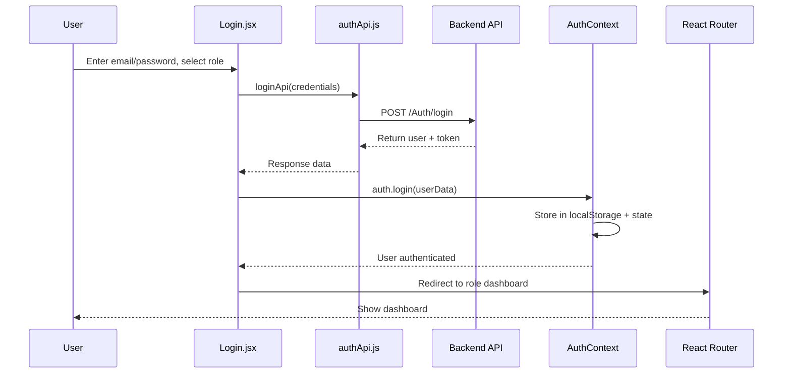
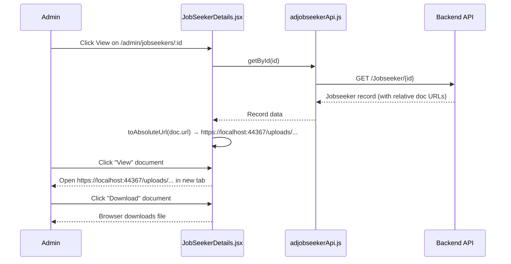

# Business Workflows

This document describes major end-to-end workflows in the Ishraq Admin Panel, from user action to final result. All workflows are derived from the actual source code.

---

## Workflow 1: User Login

### Participants
- User (browser)
- Login page (`src/pages/auth/Login.jsx`)
- Auth API (`src/api/authApi.js`)
- Auth Context (`src/context/AuthContext.jsx`)

### Steps

| Step | Actor | Action |
|------|-------|--------|
| 1 | User | Navigates to `/login` |
| 2 | User | Selects role (Admin / Employer / Job Seeker) |
| 3 | User | Enters email and password, clicks "Sign in" |
| 4 | Login.jsx | Calls `loginApi(credentials)` → `POST /Auth/login` |
| 5 | Backend API | Validates credentials, returns user data + token |
| 6 | Login.jsx | Calls `auth.login(userData)` → stores in `localStorage` + React state |

---

## Workflow 2: Forgot Password (OTP Reset)

### Participants
- User
- ForgotPassword page (`src/pages/auth/ForgotPassword.jsx`)
- Auth API

### Steps

| Step | Actor | Action |
|------|-------|--------|
| 1 | User | Navigates to `/forgot-password`, enters email |
| 2 | ForgotPassword.jsx | Calls `sendForgotPasswordOtpApi(email)` → `POST /EmailOtp/send-otp` |
| 3 | Backend | Sends OTP to email |
| 4 | User | Receives OTP, enters it on step 2 |
| 5 | ForgotPassword.jsx | Calls `verifyForgotPasswordOtpApi(email, otp)` → `POST /EmailOtp/verify-otp` |
| 6 | User | Enters new password on step 3 |
| 7 | ForgotPassword.jsx | Calls `updatePasswordByEmailApi(email, pass)` → `PATCH /Auth/UpdatePasswordyEmail` |
| 8 | Backend | Resets password |
| 9 | User | Redirected to `/login` |

### Business Rules
- 4-step process: email → OTP verification → new password → done
- OTP is 6 digits, numeric input
- Resend OTP option available

---

## Workflow 3: Admin Views Job Seeker Details (with Documents)

### Participants
- Admin user
- Job Seekers list (`JobSeekers.jsx`)
- Job Seeker Details (`JobSeekerDetails.jsx`)
- Jobseeker API (`adjobseekerApi.js`)
- Application API (`applicationApi.js`)

### Steps

| Step | Actor | Action |
|------|-------|--------|
| 1 | Admin | Navigates to `/admin/jobseekers` |
| 2 | JobSeekers.jsx | Calls `jobseekerApi.getAll()` → `GET /Jobseeker` |
| 3 | Admin | Clicks "View" on a job seeker |
| 4 | Router | Navigates to `/admin/jobseekers/:id` |

---

## Workflow 4: Admin Creates Job Requirement

### Participants
- Admin user
- Job Requirement Create page (`Jobrequirementcreate.jsx`)
- Job Requirement API (`jobRequirementApi.js`)

### Steps

| Step | Actor | Action |
|------|-------|--------|
| 1 | Admin | Navigates to `/admin/job-requirements/create` |
| 2 | Jobrequirementcreate.jsx | Loads master data (job categories, roles, statuses, employment types) via `getAllList()` endpoints |
| 3 | Admin | Fills job details (title, description, location, salary, deadline, etc.) |
| 4 | Admin | Attaches files (job description, etc.) |
| 5 | Admin | Clicks "Create" |
| 6 | Jobrequirementcreate.jsx | Calls `jobRequirementApi.create(formData)` → `POST /JobRequirement` with `multipart/form-data` |
| 7 | Backend | Creates job requirement, saves attachments |
| 8 | Admin | Redirected to job requirement list |

### Business Rules
- File uploads use `multipart/form-data`
- Required fields must be filled before submission
- Status defaults to Active

---

## Workflow 5: Employer Posts a Job

### Participants
- Employer user
- Employer Job Requirement Create page
- Job Requirement API

### Steps

| Step | Actor | Action |
|------|-------|--------|
| 1 | Employer | Navigates to `/employer/job-requirements/create` |
| 2 | Jobrequirementcreate.jsx | Loads master data for dropdowns |
| 3 | Employer | Fills job details and attaches files |
| 4 | Employer | Clicks "Create" |
| 5 | Jobrequirementcreate.jsx | Calls `jobRequirementApi.create(formData)` → `POST /JobRequirement` |
| 6 | Backend | Creates job requirement linked to employer |
| 7 | Employer | Redirected to job list (`/employer/jobs`) |

---

## Workflow 6: Job Seeker Applies for a Job

### Participants
- Job Seeker user
- Jobs For You page (`JobsForYou.jsx`)

---

## Workflow 7: Admin Manages Master Data

### Participants
- Admin user
- Master Data Form (`MasterDataForm.jsx`)
- Generic CRUD API (`createMasterApi.js`)

### Steps

| Step | Actor | Action |
|------|-------|--------|
| 1 | Admin | Navigates to a master data section (e.g., `/admin/settings/master/cityMaster`) |
| 2 | MasterDataForm.jsx | Calls `cityMasterApi.getAll()` → `GET /CityMaster` (paginated) |
| 3 | Admin | Clicks "Add" |
| 4 | MasterDataForm.jsx | Mode = "create", shows empty form |
| 5 | Admin | Fills name and status, clicks "Save" |
| 6 | MasterDataForm.jsx | Calls `cityMasterApi.create(payload)` → `POST /CityMaster` |
| 7 | Backend | Creates master data record |
| 8 | Admin | List refreshes with new record |

### Business Rules
- Name field is required
- Status: Active / Inactive dropdown
- Generic form works for all master data entities via `createMasterApi` factory

---

## Workflow 8: Admin Enquiry Management

### Participants
- Admin user
- Complaint List (`ComplaintList.jsx`)
- Admin Enquiry Service (`adminEnquiryService.js`)

### Steps

| Step | Actor | Action |
|------|-------|--------|
| 1 | Admin | Navigates to `/admin/complaints` |
| 2 | ComplaintList.jsx | Calls `adminEnquiryService.list("complaint", page, limit)` → `GET /Complaint?pageNo=&pageSize=` |
| 3 | Admin | Clicks on a complaint to view details |
| 4 | ComplaintDetails.jsx | Calls `adminEnquiryService.getById("complaint", id)` → `GET /Complaint/{id}` |
| 5 | Admin | Updates status or response on detail page |
| 6 | ComplaintDetails.jsx | Calls `adminEnquiryService.updateEnquiryStatus("complaint", id, payload)` or `updateEnquiryResponse(...)` |
| 7 | Backend | Updates enquiry record |
| 8 | Admin | Sees success toast |

### Business Rules
- Contact enquiries do not support active status toggle
- File attachments can be opened via `openFile()` which creates a blob URL

---

## Mermaid Diagram: Login Flow

---

## Mermaid Diagram: Job Seeker Document View/Download

---

## Limitations

- Workflows involving sample/mock data (dashboards, Users page) do not make real API calls
- Backend business logic (validation, authorization, data persistence) is not visible from the frontend
- File upload processing on backend is inferred but not verified

- Job Details page (`JobDetails.jsx`)
- Application API (`applicationApi.js`)

### Steps

| Step | Actor | Action |
|------|-------|--------|
| 1 | Job Seeker | Navigates to `/jobseeker/job-list` |
| 2 | JobsForYou.jsx | Calls `jobRequirementApi.getJobsForJobseeker()` → `GET /JobRequirement` with filters |
| 3 | Job Seeker | Clicks on a job to view details |
| 4 | Router | Navigates to `/jobseeker/jobs/:id` |
| 5 | JobDetails.jsx | Calls `jobRequirementApi.getJobRequirementById(id)` → `GET /JobRequirement/{id}` |
| 6 | Job Seeker | Clicks "Apply" |
| 7 | JobDetails.jsx | Calls `applicationApi.applyForJob(payload)` → `POST /Application` |
| 8 | Backend | Creates application record |
| 9 | Job Seeker | Sees confirmation; application appears in "Applied Jobs" |

| 5 | JobSeekerDetails.jsx | Calls `jobseekerApi.getById(id)` → `GET /Jobseeker/{id}` |
| 6 | JobSeekerDetails.jsx | Calls `applicationApi.getAppliedJobs(jobseekerId)` → `GET /Application?jobseekerId=` |
| 7 | JobSeekerDetails.jsx | For each document URL, calls `toAbsoluteUrl(url)` to resolve relative paths against `https://localhost:44367` |
| 8 | Admin | Views tabs: Overview, Location & Preferences, Documents, Applied Jobs |
| 9 | Admin | Clicks "View" on a document → opens `https://localhost:44367/uploads/...` in new tab |
| 10 | Admin | Clicks "Download" on a document → triggers browser download |

### Business Rules
- Document URLs from backend may be relative paths (e.g., `uploads/jobseeker-cvs/....pdf`)
- `toAbsoluteUrl()` resolves relative paths by prefixing with `API_BASE_URL`
- Absolute URLs (starting with `http(s)://`) are passed through unchanged
- View links use `target="_blank"`; Download links use `download` attribute

| 7 | AuthContext | User session established, `isAuthenticated` becomes `true` |
| 8 | React Router | Redirects to role-based dashboard |

### Business Rules
- Role normalization: `"Recruiter"` → `"employer"`, `"Admin"` → `"admin"`, `"Jobseeker"` → `"jobseeker"`
- Invalid credentials → error toast displayed
- Caps Lock warning shown on password field
